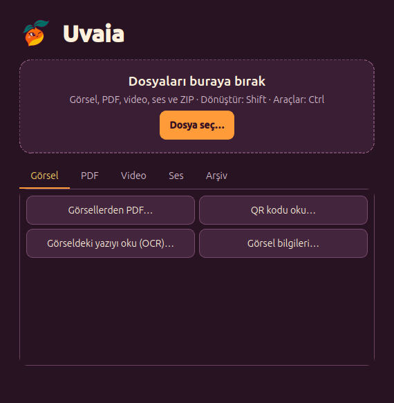
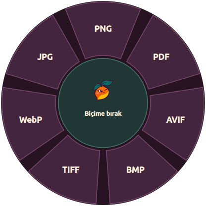
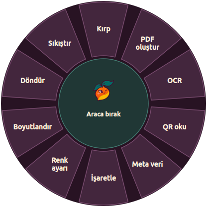
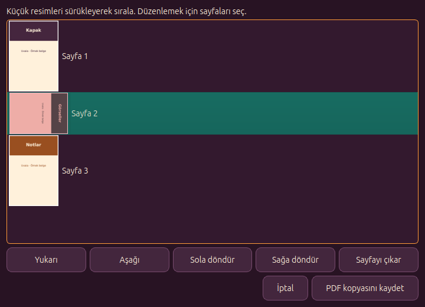
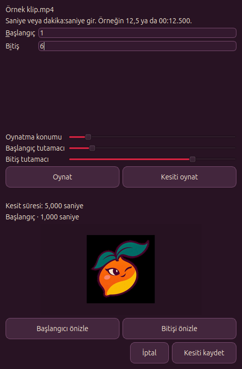

# Uvaia

Uvaia, Linux Mint Cinnamon için yerel dosya dönüştürme ve düzenleme uygulamasıdır. Görselleri, PDF’leri, videoları, ses dosyalarını ve ZIP arşivlerini dosya yöneticisinden sürükleyerek işleyebilirsin. Çıktılar kaynak dosyaların yanına yeni dosya olarak kaydedilir.



## Kurulum

### Linux Mint paketi

Elindeki AMD64 paketini Cinnamon paket yükleyicisiyle açabilir veya terminalden kurabilirsin.

```bash
sudo apt install ./uvaia_0.1.1_amd64.deb
```

### Kaynak koddan çalıştırma

```bash
python3 -m venv .venv
.venv/bin/python -m pip install -r requirements.txt
.venv/bin/python uvaia.py
```

Kaynak kurulumunu Cinnamon menüsüne ve Nemo sağ tık menüsüne eklemek için `.venv/bin/python install_desktop.py` çalıştır. OCR için `tesseract-ocr`, `tesseract-ocr-tur` ve `tesseract-ocr-eng` paketleri gerekir.

## Shift ve Ctrl çarkları

Nemo’da dosyayı sürüklerken **Shift** ile biçim çarkını aç. Fareyi basılı tutarak Shift’i bırak, istediğin biçime git ve dosyayı bırak. **Ctrl** ile dosyaya uygun araçları açabilir ve Ctrl basılıyken seçtiğin araca bırakabilirsin. Çark kısayolları X11 oturumu gerektirir.

| Shift · Biçimler | Ctrl · Araçlar |
| --- | --- |
|  |  |

## Özellikler

| Dosya türü | Yapabileceklerin |
| --- | --- |
| Görsel | Biçim dönüştürme, kırpma, boyutlandırma, sıkıştırma, renk ayarı, işaretleme, gizleme, meta veri temizleme, QR ve OCR |
| PDF | Sayfaları sürükleyerek sıralama, döndürme, çıkarma, bölme, birleştirme, görsel veya metne aktarma, QR ve OCR |
| Video | Biçim dönüştürme, oynatarak kesme, birleştirme, sıkıştırma, hız değiştirme, kare alma ve sesi kaldırma veya çıkarma |
| Ses | Biçim dönüştürme, oynatarak kesme, birleştirme, ses düzeyini dengeleme ve mono/stereo çıktı |
| ZIP | Arşiv oluşturma ve açma |

| PDF sayfa düzenleyici | Video kesme |
| --- | --- |
|  |  |

Desteklenen biçimler, toplu işlemler ve çıktı seçenekleri [kullanım kılavuzunda](docs/kullanim.md).

## Proje yapısı

| Konum | İçerik |
| --- | --- |
| [`uvaia.py`](uvaia.py), [`install_desktop.py`](install_desktop.py) | Uygulama ve masaüstü entegrasyonu için giriş noktaları |
| [`uvaia_app/`](uvaia_app/) | Ana pencere, çark işlemleri ve masaüstü entegrasyonu |
| [`uvaia_app/core/`](uvaia_app/core/) | Dosya işleme, dönüştürme ve çıktı kaydetme |
| [`uvaia_app/ui/`](uvaia_app/ui/) | Qt pencereleri, önizlemeler ve sürükle-bırak çarkı |
| [`assets/`](assets/), [`docs/`](docs/), [`tools/`](tools/) | Logo, kullanım kılavuzu, ekran görüntüleri ve paketleme betiği |

Mint paketi üretmek için sanal ortama PyInstaller kur ve `tools/build_deb.sh` çalıştır. Paket `dist/` klasörüne yazılır.

Sürükle-bırak çarkı [Nashi](https://github.com/orkunisitmak/nashi-app) uygulamasından ilham alır.
